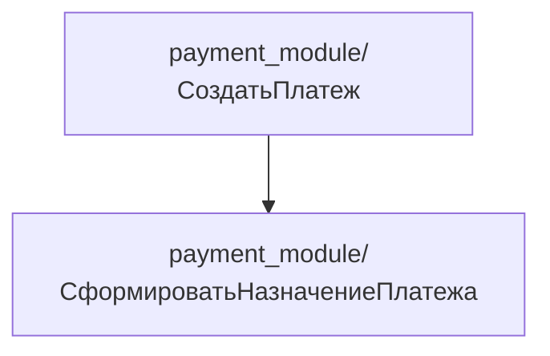

# Semantic 1C Code Search

[English](README.en.md) · Русский

[](https://github.com/sergey-lastochkin/semantic-1c-code-search/actions/workflows/ci.yml)
[](https://www.python.org/)
[](LICENSE)
[](https://github.com/sergey-lastochkin/semantic-1c-code-search/releases/latest)

Поиск по выгруженному коду 1С прямо у себя на компьютере. Указываете папку с выгрузкой конфигурации, спрашиваете словами или именем процедуры, а в ответ получаете модуль, процедуру и номера строк. Платформа 1С не нужна, и код никуда не уходит.


<sub>Это настоящая запись терминала на открытом корпусе из бенчмарка. Как перезаписать - в [scripts/demo](scripts/demo/README.md).</sub>

Сделал, потому что сам постоянно залезаю в чужие конфигурации, а там десятки тысяч процедур. Поиск в Конфигураторе и `grep` выдают все строки подряд без всякого порядка: даже в небольшом корпусе из бенчмарка слово «таймаут» встречается 69 раз в 10 файлах, сиди и разбирай. Здесь модули режутся на процедуры и функции, и ранжируются они целиком, по имени, параметрам, переменным, комментариям и строкам внутри. В ответе короткий список процедур с путём и строками. А для вопросов обычными словами есть режим `hybrid` с локальной языковой моделью. Пригодится, если пришли в чужую или давно забытую конфигурацию, если до оценки доработки надо найти все места про оплату, обмен или конкретный регистр, и если код нельзя отдавать во внешние AI-сервисы.

## Поставить

На Windows проще всего готовым wheel:

```powershell
git clone --depth 1 https://github.com/sergey-lastochkin/semantic-1c-code-search.git
cd semantic-1c-code-search
py -3.11 -m venv .venv
.\.venv\Scripts\python.exe -m pip install "https://github.com/sergey-lastochkin/semantic-1c-code-search/releases/download/v0.1.1/1c_semantic_code_search-0.1.1-py3-none-any.whl"
.\.venv\Scripts\code-search.exe search examples "СформироватьНазначениеПлатежа"
```

SHA-256 wheel лежит в [релизе `v0.1.1`](https://github.com/sergey-lastochkin/semantic-1c-code-search/releases/tag/v0.1.1). На macOS и Linux из исходников:

```bash
git clone https://github.com/sergey-lastochkin/semantic-1c-code-search.git
cd semantic-1c-code-search
python3.11 -m venv .venv
.venv/bin/python -m pip install .
.venv/bin/code-search search examples "СформироватьНазначениеПлатежа"
```

Чтобы искать по своей базе, выгрузите конфигурацию в файлы (Конфигуратор → «Выгрузить конфигурацию в файлы» или EDT) и укажите папку:

```bash
code-search search /path/to/config-export "таймаут соединения" --k 5
code-search search /path/to/config-export "basic авторизация" --json   # для скриптов
```

## Как выглядит

Запрос по тем же 577 открытым BSL-файлам, что в ролике:

```text
$ code-search search corpus 'таймаут соединения' --k 3
1. Таймаут  [Connector/src/ru/CommonModules/КоннекторHTTP/Ext/Module:2035-2047]
   Функция Таймаут(ДополнительныеПараметры)

2. УстановитьТаймаут  [yaxunit/tests/src/CommonModules/Обр_ЮТHTTPСоединение_МО/Module:175-187]
   Процедура УстановитьТаймаут() Экспорт

3. КонструкторПоУмолчанию  [yaxunit/tests/src/CommonModules/Обр_ЮТHTTPСоединение_МО/Module:187-264]
   Процедура КонструкторПоУмолчанию() Экспорт
```

Ещё умеет строить статический граф вызовов:

```bash
code-search graph examples --format mermaid
```



По умолчанию работает `bm25`: он хорош для имён, реквизитов и терминов из кода, ставить ничего не надо. Для вопросов обычными словами есть `hybrid`, он объединяет BM25 и локальную модель `intfloat/multilingual-e5-small` (ревизия закреплена) через RRF. Ставится через `pip install '.[embeddings]'`, модель скачивается один раз при первом запуске, дальше всё считается локально. Ещё есть сохранение индекса (`code-search index`), локальный интерфейс на FastAPI и адаптеры in-memory, Qdrant local, FAISS и pgvector.

## Насколько хорошо ищет

Корпус - 577 BSL-файлов из трёх открытых проектов под Apache-2.0 (Connector, YAxUnit, xUnitFor1C): 156 869 строк, 7 342 процедуры и функции. Хэши коммитов и SHA-256 каждого файла - в [манифесте](studies/oss-bsl-corpus-2026-08-10/corpus-manifest.json).

| Набор запросов | BM25 | Embeddings | RRF |
| --- | ---: | ---: | ---: |
| 90 точных (имена, вызовы, метаданные), Recall@5 | **0.856** | 0.640 | 0.830 |
| 29 вопросов на русском, проверенных вручную, Recall@5 | 0.138 | **0.345** | 0.276 |
| Те же 29 вопросов, Recall@10 | 0.207 | 0.379 | **0.414** |

Если честно: по именам BM25 почти всегда находит нужное в первой пятёрке. На вопросах обычными словами эмбеддинги лучше в 2,5 раза, но нужная процедура попадает в пятёрку где-то в трети случаев. 29 вопросов - это мало, так что это ориентир, а не окончательная оценка. Подробно - в [методике и таблицах](docs/benchmark.md) и [описании корпуса](docs/corpus.md).

## Чего он не умеет

Парсер статический и на эвристиках, компилятор и запуск 1С он не заменяет. Динамические вызовы (`Выполнить`, имена, собранные в строке), препроцессор и расширения видит не полностью, подробнее в [границах парсера](docs/parser-limits.md). Бенчмарк собран на открытых библиотеках, а не на типовой коммерческой конфигурации. BM25 ищет целыми словами, без морфологии и без разбивки `ИменСоставныхИдентификаторов`, так что «таймаута» не найдёт «таймаут», для этого нужен `hybrid`. Нужен Python 3.11+, отдельного `.exe` пока нет.

Для разработки:

```bash
.venv/bin/python -m pip install -e '.[dev]'
.venv/bin/python -m pytest
.venv/bin/python -m ruff check src scripts tests
```

CI гоняет это на Windows и Ubuntu, Python 3.11 и 3.12. Как помочь - в [CONTRIBUTING.md](CONTRIBUTING.md). Только не прикладывайте к issues закрытые конфигурации и персональные данные.

Нужно поставить поиск по вашей конфигурации, разобраться в чужом коде или сделать интеграцию 1С с внешним сервисом - пишите в Telegram [t.me/metaanswer](https://t.me/metaanswer). Сергей Ласточкин. Лицензия [Apache 2.0](LICENSE).
